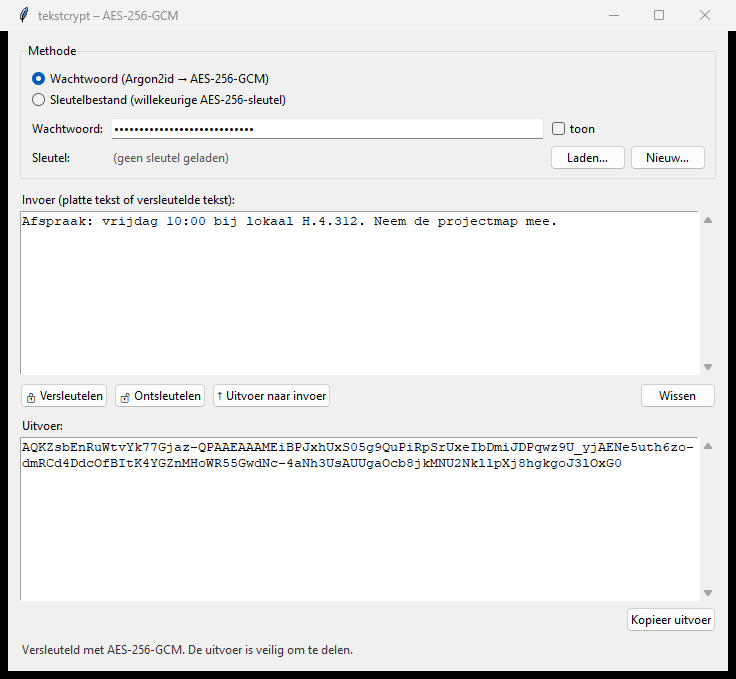
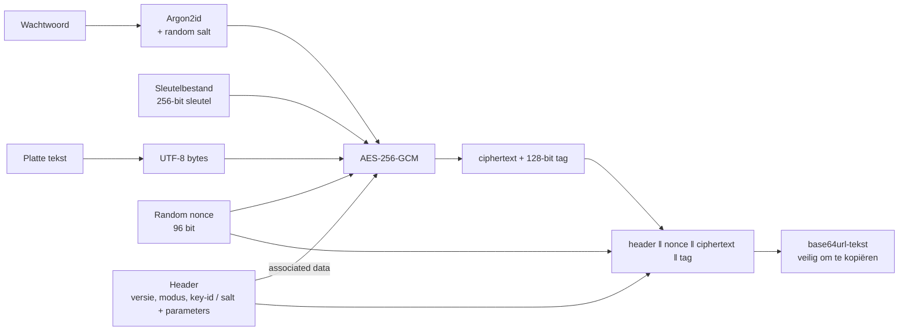

# tekstcrypt: tekst versleutelen met AES-256-GCM

**Auteur:** Yavuz
**Opdracht:** Symmetrische encryptie-applicatie (Werkplaats Security)

`tekstcrypt` is een kleine Python-applicatie waarmee je tekst kunt versleutelen en ontsleutelen. Je kunt hem gebruiken via een **command-line interface (CLI)** of via een **grafische interface (GUI)**. Alle cryptografie komt uit de bekende, goed geteste library [`cryptography`](https://cryptography.io) (pyca). Ik heb zelf geen enkel cryptografisch algoritme geïmplementeerd: *don't roll your own crypto*.



---

## Inhoud

1. [Snel starten](#1-snel-starten)
2. [Hoe de applicatie werkt](#2-hoe-de-applicatie-werkt)
3. [Onderzoek: symmetrische en asymmetrische encryptie](#3-onderzoek-symmetrische-en-asymmetrische-encryptie)
4. [Gekozen algoritme: AES-256-GCM](#4-gekozen-algoritme-aes-256-gcm)
5. [Sleutelbeheer](#5-sleutelbeheer)
6. [Reflectie op Kerckhoffs's principe](#6-reflectie-op-kerckhoffss-principe)
7. [Beperkingen en verbeterpunten](#7-beperkingen-en-verbeterpunten)
8. [Tests en codekwaliteit](#8-tests-en-codekwaliteit)
9. [Bronnen](#9-bronnen)

---

## 1. Snel starten

**Vereisten:** Python 3.10 of hoger (Tkinter zit standaard bij Python op Windows en macOS).

```bash
git clone <url-van-deze-repo>
cd encryptie-app
python -m venv .venv
.venv\Scripts\activate          # Windows
# source .venv/bin/activate     # Linux/macOS
pip install -r requirements.txt
```

### Grafische interface

```bash
python -m tekstcrypt gui
```

1. Kies **Wachtwoord** of **Sleutelbestand** (met *Nieuw…* maak je een sleutel, met *Laden…* open je er een).
2. Typ of plak tekst in *Invoer* en klik op **Versleutelen**.
3. Kopieer de uitvoer en stuur die naar de ontvanger.
4. De ontvanger plakt de versleutelde tekst in *Invoer* en klikt op **Ontsleutelen**. De applicatie ziet zelf of het bericht met een wachtwoord of een sleutelbestand is versleuteld.

### Command-line interface

```text
python -m tekstcrypt --help

  genereer-sleutel  maak een nieuw AES-256-sleutelbestand
  vingerafdruk      toon de vingerafdruk van een sleutel
  versleutel        versleutel tekst
  ontsleutel        ontsleutel tekst
  gui               start de grafische interface
```

**Met een sleutelbestand:**

```text
> python -m tekstcrypt genereer-sleutel -o alice-bob.key --beveilig
Wachtwoord voor het sleutelbestand: ********
Herhaal wachtwoord voor het sleutelbestand: ********
Nieuwe AES-256-sleutel opgeslagen in 'alice-bob.key' (beveiligd met wachtwoord).
Vingerafdruk: 01DA-C562-D1C9-FF5D-C83A-5DB0-4EFC-905C

> python -m tekstcrypt versleutel -s alice-bob.key -t "Hallo docent!"
AQEB2sVi0cn_XRgQZaPs76aRvShk1-9cGb_qw3yuSlHiExIqP4yWQtCywsBPwx4kaSeo

> python -m tekstcrypt ontsleutel -s alice-bob.key -t AQEB2sVi0cn_XRgQ...
Hallo docent!
```

**Met een wachtwoord** (het wachtwoord wordt altijd gevraagd en nooit als argument meegegeven):

```bash
python -m tekstcrypt versleutel --wachtwoord -i geheim.txt -o geheim.enc
python -m tekstcrypt ontsleutel -i geheim.enc
```

Invoer kan komen uit `-t "tekst"`, uit een bestand (`-i`) of uit stdin (pipe). Met `-o` schrijf je het resultaat naar een bestand.

---

## 2. Hoe de applicatie werkt

### Architectuur

```text
tekstcrypt/
├── crypto.py   AES-256-GCM versleutelen/ontsleutelen + berichtformaat
├── kdf.py      Argon2id: sleutel afleiden uit een wachtwoord
├── keys.py     sleutelbeheer: genereren, opslaan, laden, vingerafdruk
├── errors.py   eigen foutklassen met begrijpelijke meldingen
├── cli.py      command-line interface (argparse)
└── gui.py      grafische interface (Tkinter)
tests/          53 pytest-tests
```

De CLI en de GUI bevatten **geen cryptografie**. Ze roepen allebei dezelfde functies uit `crypto.py` en `keys.py` aan. Daardoor gebeurt de beveiligingsgevoelige logica op één plek, en die plek is goed te testen.

### Twee manieren om te versleutelen

| | **Sleutelbestand-modus** | **Wachtwoord-modus** |
|---|---|---|
| Waar komt de AES-sleutel vandaan? | 256 willekeurige bits uit de CSPRNG van het besturingssysteem | Afgeleid uit het wachtwoord met Argon2id (+ willekeurige salt per bericht) |
| Sterkte | Altijd 256 bit | Zo sterk als het wachtwoord |
| Delen met de ontvanger | Het sleutelbestand moet veilig bij de ontvanger komen | Het wachtwoord moet veilig worden afgesproken |
| Geschikt voor | Vaste communicatiepartners | Af en toe een bericht, of als je geen bestanden wilt uitwisselen |

### Wat er gebeurt bij versleutelen



Bij ontsleutelen gaat het omgekeerd. AES-GCM controleert eerst de **authenticatietag**. Als er ook maar één bit van de header, nonce of ciphertext is veranderd, of als de sleutel verkeerd is, weigert de applicatie het bericht. Je krijgt dan dus nooit "half goede" of gemanipuleerde tekst terug.

### Berichtformaat

Een versleuteld bericht is één regel base64url-tekst. Daarin zit:

| Veld | Bytes | Sleutelbestand | Wachtwoord | Geheim? |
|---|---|---|---|---|
| versie | 1 | `1` | `1` | nee |
| modus | 1 | `1` | `2` | nee |
| key-id | 8 | ✓ | – | nee (hash van de sleutel) |
| salt | 16 | – | ✓ | nee |
| Argon2id geheugen (KiB), iteraties, lanes | 4 + 1 + 1 | – | ✓ | nee |
| nonce | 12 | ✓ | ✓ | nee |
| ciphertext | n | ✓ | ✓ | versleuteld |
| GCM-tag | 16 | ✓ | ✓ | nee |

Alles vóór de nonce is de *header*. De header gaat als **associated data (AAD)** mee in AES-GCM. Hij is dus niet geheim, maar wel beschermd tegen manipulatie. Een aanvaller kan bijvoorbeeld de Argon2id-parameters of de modus niet ongemerkt veranderen. Het versienummer zorgt dat het formaat later kan worden uitgebreid, bijvoorbeeld met een ander algoritme, zonder dat oude berichten onleesbaar worden.

---

## 3. Onderzoek: symmetrische en asymmetrische encryptie

### Symmetrische encryptie

Bij symmetrische encryptie gebruiken zender en ontvanger **dezelfde geheime sleutel** om te versleutelen en te ontsleutelen. Bekende algoritmen zijn AES (blokcijfer) en ChaCha20 (stroomcijfer). Oudere, inmiddels onveilige algoritmen zijn DES en RC4.

- **Voordelen:** heel snel (AES heeft hardware-ondersteuning via AES-NI), korte sleutels (128 tot 256 bit zijn genoeg) en geschikt voor grote hoeveelheden data.
- **Nadeel:** het **sleuteldistributieprobleem**. Beide partijen moeten de sleutel al hebben voordat ze veilig kunnen communiceren. Hoe krijg je die sleutel veilig bij de ander, als je juist nog geen veilig kanaal hebt?

### Asymmetrische encryptie

Bij asymmetrische encryptie (public-key cryptografie, Diffie & Hellman 1976, RSA 1977) heeft elke gebruiker een **sleutelpaar**: een **publieke sleutel** die iedereen mag kennen en een **privésleutel** die geheim blijft. Wat met de publieke sleutel is versleuteld, kan alleen met de bijbehorende privésleutel worden ontsleuteld. Voorbeelden zijn RSA, elliptische krommen (X25519, ECDSA, Ed25519) en de nieuwe post-quantum-algoritmen zoals ML-KEM.

- **Voordelen:** het distributieprobleem verdwijnt grotendeels (je publieke sleutel mag op je website staan) en digitale handtekeningen worden mogelijk (authenticiteit en onweerlegbaarheid).
- **Nadelen:** het is honderden tot duizenden keren trager dan symmetrische encryptie, heeft veel langere sleutels nodig voor dezelfde sterkte (RSA-3072 ≈ AES-128) en is alleen geschikt voor kleine hoeveelheden data. Daarnaast moet je nog steeds kunnen controleren *van wie* een publieke sleutel is (PKI, certificaten).

### Vergelijking

| | Symmetrisch | Asymmetrisch |
|---|---|---|
| Sleutels | 1 gedeelde geheime sleutel | Publieke + privésleutel per gebruiker |
| Snelheid | Zeer snel | Traag |
| Sleutellengte voor ~128-bit sterkte | 128 bit (AES) | 3072 bit (RSA) / 256 bit (ECC) |
| Aantal sleutels voor *n* gebruikers | *n(n−1)/2* | *2n* |
| Grootste probleem | Sleutel veilig uitwisselen | Echtheid van publieke sleutels |
| Typisch gebruik | Bulkdata versleutelen | Sleuteluitwisseling, handtekeningen |

**In de praktijk worden ze gecombineerd (hybride encryptie).** TLS (HTTPS), Signal, PGP en SSH gebruiken asymmetrische cryptografie om een willekeurige symmetrische *sessiesleutel* af te spreken of te versturen. De eigenlijke data wordt daarna met AES-GCM of ChaCha20-Poly1305 versleuteld. Zo heb je het gemak van asymmetrisch en de snelheid van symmetrisch.

### Fundamentele cryptografieprincipes

- **Kerckhoffs's principe (1883):** een cryptosysteem moet veilig blijven, ook als alles behalve de sleutel publiek bekend is. Claude Shannon formuleerde dit later als *"the enemy knows the system"* (Shannon's maxim). Zie [hoofdstuk 6](#6-reflectie-op-kerckhoffss-principe).
- **Geen *security through obscurity*:** geheimhouding van het ontwerp mag nooit de bron van veiligheid zijn. Geheime algoritmen zijn in het verleden steeds gebroken zodra ze werden ge-reverse-engineerd, bijvoorbeeld CSS (dvd's), A5/1 (GSM) en Crypto-1 (MIFARE Classic, ook in de oude OV-chipkaart).
- **Confusion en diffusion (Shannon, 1949):** de relatie tussen sleutel en ciphertext moet zo complex mogelijk zijn (*confusion*), en een kleine verandering in de invoer moet zich over de hele uitvoer verspreiden (*diffusion*). AES bereikt dit met zijn rondes van SubBytes, ShiftRows, MixColumns en AddRoundKey.
- **CIA-triade:** encryptie alleen levert *vertrouwelijkheid* (confidentiality). Voor *integriteit* en *authenticiteit* heb je een MAC of een AEAD-modus nodig. Daarom gebruikt deze applicatie GCM.
- **Don't roll your own crypto:** zelfs met een veilig algoritme gaat het vaak mis in de details: nonce-hergebruik, padding-oracles, timing-lekken, zwakke random-generators. Daarom gebruikt deze applicatie alleen de primitieven van `cryptography`, een library die bovenop OpenSSL is gebouwd, intensief wordt onderhouden en wordt gebruikt door onder andere pip, Ansible en veel cloud-SDK's.
- **Een sleutel moet echt willekeurig zijn:** sleutels komen uit een *cryptographically secure pseudo-random number generator* (CSPRNG), nooit uit Python's `random`-module, een tijdstempel of iets anders dat voorspelbaar is.

---

## 4. Gekozen algoritme: AES-256-GCM

### Waarom AES?

- **AES** (Rijndael) is sinds 2001 de wereldwijde standaard (NIST FIPS 197). Het is gekozen via een open, internationale competitie en is ruim twintig jaar intensief onderzocht door cryptanalisten. Er is geen praktische aanval op volledig AES bekend.
- AES heeft hardware-ondersteuning (AES-NI) in vrijwel alle moderne processors. Het is daardoor snel en minder gevoelig voor timing-aanvallen dan software-implementaties.
- De opdracht noemt AES expliciet als moderne, veilige keuze.

### Waarom 256 bit en niet 128?

AES-128 is met de huidige computers in de praktijk niet te kraken. Ik kies toch voor **AES-256**:

- **Veiligheidsmarge tegen quantumcomputers:** het algoritme van Grover halveert in theorie de effectieve sleutellengte van symmetrische cijfers. AES-256 houdt dan nog ~128 bit sterkte over, AES-128 maar ~64 bit.
- **De extra kosten zijn verwaarloosbaar:** 14 in plaats van 10 rondes. Voor korte tekstberichten merk je daar niets van.
- AES-256 is ook goedgekeurd voor gerubriceerde informatie tot TOP SECRET (NSA CNSA-suite).

### Waarom de GCM-modus?

AES zelf versleutelt alleen blokken van 16 bytes. Een *mode of operation* bepaalt hoe je langere teksten veilig versleutelt. Die keuze is minstens zo belangrijk als de keuze voor AES zelf:

| Modus | Vertrouwelijkheid | Integriteit | Opmerking |
|---|---|---|---|
| ECB | ✗ (lekt patronen) | ✗ | Identieke blokken geven identieke ciphertext (het bekende "ECB-pinguïn"-plaatje). Nooit gebruiken. |
| CBC | ✓ | ✗ | Heeft een aparte HMAC nodig. Zonder HMAC kwetsbaar voor padding-oracle-aanvallen. |
| CTR | ✓ | ✗ | Ciphertext is "kneedbaar": bits omdraaien draait dezelfde bits in de platte tekst om. |
| **GCM** | ✓ | ✓ | **AEAD**: versleutelt én authenticeert in één stap (NIST SP 800-38D). |

Met **GCM (Galois/Counter Mode)** krijg je *authenticated encryption with associated data*. Een aanvaller die de versleutelde tekst onderschept, kan die niet lezen en ook niet ongemerkt aanpassen. In de tests (`test_tampered_ciphertext_is_detected`) draai ik één bit om, en het bericht wordt dan geweigerd.

**Nonce-beheer.** GCM heeft per bericht een unieke *nonce* (number used once) van 96 bit nodig. Als dezelfde nonce twee keer met dezelfde sleutel wordt gebruikt, is GCM volledig gebroken: de XOR van de platte teksten lekt, en een aanvaller kan berichten vervalsen. Daarom maakt de applicatie bij **elk** bericht een nieuwe nonce met `os.urandom(12)`. Met willekeurige nonces raadt NIST aan om niet meer dan 2³² berichten met één sleutel te versleutelen. Dat is ruim vier miljard, en voor deze toepassing ruim voldoende.

**Alternatief: ChaCha20-Poly1305.** Dit is net zo veilig, ook een AEAD, en sneller op apparaten zonder AES-hardware (bijvoorbeeld oudere telefoons). Ik heb voor AES-GCM gekozen omdat de opdracht AES vraagt en omdat AES-NI op laptops en desktops vrijwel altijd beschikbaar is. Dankzij het versieveld in het berichtformaat kan later eenvoudig een ander algoritme worden toegevoegd.

### Wachtwoorden: Argon2id

Een wachtwoord is géén geschikte AES-sleutel. Het is te kort, niet willekeurig en makkelijk te raden. In de wachtwoord-modus leidt de applicatie daarom met **Argon2id** (RFC 9106, winnaar van de Password Hashing Competition 2015) een 256-bit sleutel af:

- **Parameters:** 64 MiB geheugen, 3 iteraties, 4 lanes. Dat is ruim boven het OWASP-minimum (19 MiB, 2 iteraties) en kost ongeveer 0,1 seconde per poging. Voor een gebruiker merk je daar niets van, maar een aanvaller die miljarden wachtwoorden wil proberen wordt er enorm door afgeremd. Omdat Argon2id *memory-hard* is, helpen GPU's en ASIC's de aanvaller veel minder dan bij gewone hashes zoals SHA-256.
- **Salt:** elk bericht krijgt een nieuwe willekeurige salt van 128 bit. Hetzelfde wachtwoord geeft dus per bericht een andere AES-sleutel. Vooraf berekende tabellen (rainbow tables) zijn daardoor nutteloos.
- **Parameters staan in het bericht:** zo kunnen ze later worden verhoogd zonder dat oude berichten onleesbaar worden. De applicatie hanteert wel **bovengrenzen** (max. 1 GiB, 20 iteraties, 16 lanes). Anders zou een aanvaller een bericht kunnen maken dat bij het openen gigabytes geheugen vraagt (denial of service).
- **Minimale lengte:** wachtwoorden moeten minstens 8 tekens hebben. Ze worden Unicode-genormaliseerd (NFC), zodat bijvoorbeeld een "é" op elk besturingssysteem dezelfde sleutel oplevert.

---

## 5. Sleutelbeheer

Sleutelbeheer is het moeilijkste deel van symmetrische encryptie. Het algoritme kan perfect zijn, maar als de sleutel uitlekt of onveilig wordt gedeeld, helpt dat niets. Ik bespreek de levenscyclus van de sleutel in drie stappen.

### 5.1 Generatie

```python
AESGCM.generate_key(bit_length=256)   # -> os.urandom(32)
```

- De sleutel bestaat uit 256 bits uit de **CSPRNG van het besturingssysteem** (`BCryptGenRandom` op Windows, `getrandom()` op Linux). Er zijn 2²⁵⁶ mogelijke sleutels, en daar is geen patroon in te vinden.
- Elke sleutel krijgt een **key-id** (8 bytes) en een **vingerafdruk** (128 bit, bijvoorbeeld `01DA-C562-D1C9-FF5D-…`). Beide worden afgeleid met SHA-256 en *domain separation* (`"tekstcrypt/fingerprint/v1" ‖ sleutel`). Ze verraden niets over de sleutel zelf, omdat SHA-256 niet terug te rekenen is.
  - De **key-id** staat in elk bericht. Daardoor kan de applicatie meteen melden *"dit bericht is met een andere sleutel versleuteld"*, in plaats van een vage foutmelding te geven.
  - Met de **vingerafdruk** kunnen twee gebruikers via een tweede kanaal (telefoon, persoonlijk) controleren of ze dezelfde sleutel hebben, zonder de sleutel zelf uit te spreken.
- In de wachtwoord-modus wordt de sleutel **niet opgeslagen**. Hij wordt bij elk bericht opnieuw met Argon2id afgeleid uit wachtwoord en salt, en bestaat alleen even in het geheugen.

### 5.2 Opslag

Een sleutel wordt opgeslagen in een JSON-**sleutelbestand** (`*.key`). Dat kan op twee manieren:

**Onbeveiligd:** de sleutel staat er in base64 in. Dit is handig, maar *iedereen die het bestand heeft, kan alles ontsleutelen*. De CLI waarschuwt hier expliciet voor ("ONBEVEILIGD").

**Beveiligd met een wachtwoord (aanbevolen, `--beveilig`):** de sleutel wordt *ingepakt* (key wrapping):

```text
wachtwoord ──Argon2id(salt)──► KEK (key-encryption key)
AES-256-GCM(KEK, nonce, sleutel, AAD = key-id) ──► wrapped_key
```

```json
{
  "format": "tekstcrypt-key",
  "version": 1,
  "algorithm": "AES-256-GCM",
  "key_id": "01dac562d1c9ff5d",
  "fingerprint": "01DA-C562-D1C9-FF5D-C83A-5DB0-4EFC-905C",
  "protected": true,
  "kdf": { "name": "argon2id", "salt": "…", "memory_cost": 65536, "iterations": 3, "lanes": 4 },
  "nonce": "…",
  "wrapped_key": "…"
}
```

Wie het bestand steelt, heeft nog steeds het wachtwoord nodig en moet daarvoor per poging de dure Argon2id-berekening doen. Omdat de key-id als AAD meedoet, merkt de applicatie het ook als iemand met het bestand heeft geknoeid. Dit is in het klein hetzelfde idee als *envelope encryption* in cloud-KMS-diensten.

**Extra maatregelen bij opslag:**

- Bestanden worden aangemaakt met `O_EXCL`. Een bestaande sleutel wordt dus nooit per ongeluk overschreven (dan zou je alle berichten kwijt zijn), tenzij je dat expliciet vraagt met `--overschrijf`.
- Rechten `0600` (alleen de eigenaar mag lezen en schrijven). Dit werkt op Linux/macOS. Op Windows beschermen de NTFS-rechten van je gebruikersmap het bestand.
- `*.key` staat in `.gitignore`, zodat sleutels niet per ongeluk in een (publieke) repository terechtkomen. Dat is een veelvoorkomende oorzaak van datalekken.
- Het sleutelmateriaal zit in een `SymmetricKey`-object met `repr=False`, zodat het nooit in een foutmelding, log of debugger-weergave verschijnt.
- Wachtwoorden worden in de CLI met `getpass` gevraagd (zonder echo) en nooit als argument meegegeven. Argumenten komen namelijk in de shell-geschiedenis en zijn zichtbaar in de proceslijst.

### 5.3 Uitwisseling

Hier zit het fundamentele probleem van symmetrische encryptie: **de applicatie kan de sleutel niet zelf veilig versturen.** Als dat over hetzelfde kanaal zou gaan als de berichten, kan een afluisteraar de sleutel net zo goed onderscheppen. Daarom is de uitwisseling *out-of-band*:

**Aanbevolen werkwijze (sleutelbestand):**

1. Alice maakt een beveiligde sleutel: `genereer-sleutel -o alice-bob.key --beveilig`.
2. Alice stuurt het **bestand** via kanaal A (bijvoorbeeld e-mail of Teams). Het bestand is versleuteld, dus onderscheppen levert alleen een ingepakte sleutel op.
3. Alice geeft het **wachtwoord** via kanaal B (telefonisch, persoonlijk). Een aanvaller moet dan beide kanalen afluisteren.
4. Bob en Alice vergelijken de **vingerafdruk** (`vingerafdruk alice-bob.key`), bijvoorbeeld telefonisch. Zo weten ze zeker dat het bestand onderweg niet is vervangen door een sleutel van een aanvaller (man-in-the-middle).

**Wachtwoord-modus:** de partijen spreken vooraf persoonlijk een sterke wachtzin af. Er hoeft niets te worden verstuurd, maar de veiligheid hangt volledig af van hoe sterk dat wachtwoord is.

### 5.4 Beveiligingsimplicaties

| Risico | Gevolg | Maatregel in deze applicatie |
|---|---|---|
| Sleutelbestand uitgelekt (onbeveiligd) | Alle berichten met die sleutel zijn leesbaar, ook oude | Wachtwoordbeveiliging aanbevolen, waarschuwing in CLI, `.gitignore` |
| Sleutelbestand uitgelekt (beveiligd) | Aanvaller moet het wachtwoord offline kraken | Argon2id maakt elke poging duur, minimale wachtwoordlengte |
| Zwak wachtwoord | Offline brute-force op een onderschept bericht is mogelijk | Argon2id, minimale lengte. Echt sterke wachtwoorden blijven de verantwoordelijkheid van de gebruiker |
| Sleutel onderweg vervangen (MITM) | Aanvaller leest mee | Vingerafdruk via een tweede kanaal vergelijken |
| Bericht aangepast | Gemanipuleerde inhoud | GCM-tag: wordt altijd gedetecteerd |
| Geen *forward secrecy* | Eén gelekte sleutel ontsleutelt ook alle eerdere berichten | Sleutels regelmatig vervangen (nieuwe sleutel genereren). Echte forward secrecy vraagt om asymmetrische sleuteluitwisseling |
| Geen onweerlegbaarheid | Iedereen met de gedeelde sleutel kan berichten maken. Je kunt niet bewijzen *wie* iets stuurde | Inherent aan symmetrisch. Daarvoor heb je digitale handtekeningen nodig (asymmetrisch) |
| Sleutel intrekken | Er is geen centrale plek om een sleutel ongeldig te maken | Nieuwe sleutel genereren en opnieuw uitwisselen |

### 5.5 Het schaalbaarheidsprobleem

Bij **symmetrische encryptie** heeft elk paar gebruikers een eigen geheime sleutel nodig. Anders kan gebruiker C de berichten tussen A en B ook lezen. Voor *n* gebruikers zijn dat **n(n−1)/2** sleutels:

| Gebruikers | Benodigde sleutels |
|---:|---:|
| 2 | 1 |
| 10 | 45 |
| 100 | 4 950 |
| 1 000 | 499 500 |
| 10 000 | ~50 miljoen |

Elk van die sleutels moet veilig via een apart kanaal worden uitgewisseld, opgeslagen, regelmatig vervangen en ingetrokken als iemand vertrekt. Voor een groot aantal gebruikers is dat **praktisch onbeheersbaar**. Deze applicatie is daarom bedoeld voor een **klein aantal vaste communicatiepartners**.

In de praktijk wordt dit probleem op een van deze manieren opgelost:

1. **Asymmetrische/hybride cryptografie.** Elke gebruiker heeft één sleutelpaar (dus 2*n* sleutels in totaal). Via een sleutelafspraak zoals X25519 (Diffie-Hellman) wordt per gesprek een symmetrische sessiesleutel afgesproken. Zo werken Signal, WhatsApp en TLS. Dit levert ook *forward secrecy* op.
2. **Een vertrouwde derde partij / Key Distribution Center.** Elke gebruiker deelt één sleutel met een centrale server die sessiesleutels uitdeelt (Kerberos, gebruikt in Windows Active Directory).
3. **Key Management Systems en HSM's.** Bijvoorbeeld AWS KMS of Azure Key Vault. De hoofdsleutels verlaten de beveiligde hardware nooit, en toegang wordt centraal beheerd, gelogd en ingetrokken.

Een logische uitbreiding van deze applicatie zou een X25519-sleuteluitwisseling zijn. Daarmee wordt de sleutel niet meer handmatig gedeeld, maar met publieke sleutels afgesproken.

---

## 6. Reflectie op Kerckhoffs's principe

> *"Il faut qu'il n'exige pas le secret, et qu'il puisse sans inconvénient tomber entre les mains de l'ennemi."*
> (Het systeem mag geen geheimhouding vereisen en moet zonder bezwaar in handen van de vijand kunnen vallen.)
> Auguste Kerckhoffs, *La cryptographie militaire* (1883), tweede principe

### Wat is bij deze applicatie publiek?

Volgens Kerckhoffs moet ik ervan uitgaan dat een aanvaller **alles** weet behalve de sleutel. Bij `tekstcrypt` is dat ook echt zo:

- **De volledige broncode** staat openbaar op GitHub.
- **Het algoritme** (AES-256-GCM), de KDF (Argon2id) en de library (`cryptography`/OpenSSL) staan in deze README.
- **Het berichtformaat** is hierboven byte voor byte gedocumenteerd.
- **Elk bericht bevat zelf** de versie, de modus, de salt, de Argon2id-parameters, de nonce en de key-id, allemaal onversleuteld.

Toch kan een aanvaller met al deze kennis en een onderschept bericht **niets** met dat bericht:

- In de sleutelbestand-modus moet hij 2²⁵⁶ sleutels proberen. Dat is meer dan het geschatte aantal atomen in het waarneembare heelal en dus onmogelijk.
- In de wachtwoord-modus moet hij het wachtwoord raden, waarbij elke poging ~64 MiB geheugen en ~0,1 s kost.
- Aanpassen lukt ook niet: de GCM-tag ontdekt elke wijziging.

De **enige** geheime informatie is de sleutel (of het wachtwoord). Dat is precies wat Kerckhoffs bedoelde. Salt, nonce, key-id en parameters zijn bewust *niet* geheim: ze hoeven alleen uniek of willekeurig te zijn. Door ze openlijk mee te sturen wordt het systeem eenvoudiger en robuuster, en niet minder veilig.

### Waarom is dit beter dan geheimhouding?

Stel dat ik een eigen "geheim" algoritme had bedacht, bijvoorbeeld de letters verschuiven en daarna omdraaien. Dan zou de veiligheid volledig afhangen van het geheim blijven van die code. Zodra iemand de applicatie decompileert of de repository bekijkt, zou *elk* bericht ooit verstuurd tegelijk gebroken zijn. Bovendien zou ik niet het hele algoritme kunnen vervangen, maar alleen een sleutel. De geschiedenis staat vol met zulke gevallen: CSS bij dvd's (1999), A5/1 bij GSM, en Crypto-1 in de MIFARE Classic-chip die in de OV-chipkaart zat (2008, gebroken door onderzoekers van de Radboud Universiteit).

Doordat ik een **openbaar, gestandaardiseerd algoritme** gebruik, profiteer ik juist van meer dan twintig jaar cryptanalyse door duizenden experts. Ook de library `cryptography` is open source, zodat iedereen de implementatie kan controleren. Openheid is hier dus geen risico maar een **bron van vertrouwen**.

### Kanttekeningen

- **Het gewicht ligt volledig op de sleutel.** Kerckhoffs verplaatst het probleem naar het sleutelbeheer, en dat is precies waarom hoofdstuk 5 zo belangrijk is. Een onbeveiligd sleutelbestand op een gedeelde computer maakt AES-256 waardeloos.
- **In de wachtwoord-modus is het wachtwoord de sleutel.** De sterkte van het systeem is dan zo groot als de entropie van het wachtwoord. Argon2id vertraagt een aanvaller, maar `welkom123` blijft makkelijk te raden. Kerckhoffs' principe garandeert dus geen veiligheid als de gebruiker een zwakke sleutel kiest.
- **Vertrouwen in de implementatie.** Ik vertrouw erop dat `cryptography`/OpenSSL AES-GCM correct implementeert. Dat is in lijn met Kerckhoffs: het is een openbare, veel geauditeerde implementatie, en dat is veel betrouwbaarder dan iets wat ik zelf zou schrijven.
- **Kerckhoffs' andere principes.** Kerckhoffs formuleerde zes principes. Het derde zegt dat de sleutel *te onthouden en naar wens te veranderen* moet zijn. De wachtwoord-modus is te onthouden, en een nieuwe sleutel is met één opdracht gegenereerd. Het zesde principe zegt dat het systeem *eenvoudig te gebruiken* moet zijn, zonder lange lijsten regels. Daarom herkent de applicatie zelf de modus van een bericht en geeft ze duidelijke Nederlandse foutmeldingen.

**Conclusie:** `tekstcrypt` voldoet aan Kerckhoffs's principe. Het ontwerp, de code en zelfs alle parameters per bericht zijn openbaar, en de veiligheid hangt alleen af van de geheimhouding en kwaliteit van de sleutel. De echte uitdaging verschuift daarmee naar het sleutelbeheer, en dat is bij symmetrische encryptie met veel gebruikers vrijwel niet op te lossen zonder asymmetrische cryptografie.

---

## 7. Beperkingen en verbeterpunten

- **Lengte lekt.** Een bericht is (vóór base64) precies 38 bytes (sleutelbestand) of 52 bytes (wachtwoord) langer dan de platte tekst in UTF-8. Een aanvaller ziet dus hoe lang een bericht ongeveer is. Dit kan worden verholpen door berichten op te vullen (padding) tot vaste lengtes.
- **Geheugen.** Python kan sleutels en wachtwoorden niet betrouwbaar uit het geheugen wissen (`bytes` en `str` zijn onveranderlijk en de garbage collector bepaalt wanneer ze verdwijnen). Een aanvaller met toegang tot het werkgeheugen kan ze in theorie terugvinden.
- **Klembord en shell-geschiedenis.** Gekopieerde ontsleutelde tekst blijft op het klembord staan, en `-t "tekst"` komt in de shell-geschiedenis. Voor gevoelige tekst kun je beter `-i bestand` of stdin gebruiken.
- **Windows-bestandsrechten.** Op Windows hebben de `0600`-rechten weinig effect. Het bestand wordt beschermd door de standaard NTFS-rechten van de gebruikersmap.
- **Geen forward secrecy en geen handtekeningen.** Dat zijn inherente beperkingen van een puur symmetrisch ontwerp (zie 5.4).
- **Mogelijke uitbreidingen:** X25519-sleuteluitwisseling, sleutels opslaan in de sleutelkluis van het besturingssysteem (Windows Credential Manager / macOS Keychain via `keyring`), en een sterktemeter voor wachtwoorden (zoals `zxcvbn`).

---

## 8. Tests en codekwaliteit

```bash
pip install -r requirements.txt
python -m pytest -v
```

Er zijn **53 tests** in `tests/`. Ze controleren onder andere:

- versleutelen en weer ontsleutelen (round-trip) met sleutel en wachtwoord, ook voor lege tekst, Unicode/emoji, meerdere regels en 10 000 tekens;
- dat dezelfde tekst twee keer versleuteld een **andere** ciphertext geeft (willekeurige nonce/salt), en dat de platte tekst niet zichtbaar is in de ciphertext;
- dat een verkeerde sleutel of een verkeerd wachtwoord wordt geweigerd;
- **manipulatie**: één omgedraaide bit in de ciphertext, een aangepaste header (Argon2id-parameter) en een vervalste key-id worden alle drie gedetecteerd;
- dat kwaadaardige KDF-parameters (4 GiB geheugen) worden geweigerd *voordat* de KDF draait;
- ongeldige invoer: geen base64, afgekapte berichten, onbekende versie of modus;
- sleutelbestanden: opslaan en laden met en zonder wachtwoord, verkeerd wachtwoord, beschadigde of gemanipuleerde bestanden, niet overschrijven;
- de volledige CLI: tekst, bestanden, stdin, foutmeldingen en exitcodes.

**Ontwerpkeuzes voor codekwaliteit:**

- Aparte modules per verantwoordelijkheid (crypto, kdf, keys, cli, gui). De interfaces bevatten geen cryptografie.
- Type hints, docstrings en commentaar dat uitlegt *waarom* iets veilig is, niet alleen *wat* de code doet.
- Eigen foutklassen (`DecryptionError`, `FormatError`, …), zodat gebruikers duidelijke meldingen krijgen en geen stacktraces.
- Bewust één algemene melding bij een mislukte authenticatie ("verkeerde sleutel/wachtwoord, of de tekst is aangepast"), zodat de applicatie niet verraadt wat er precies mis is.
- Alle cryptografische primitieven (AES-GCM, Argon2id, CSPRNG) komen uit `cryptography`. SHA-256 voor de vingerafdruk komt uit Python's standaard `hashlib`.

---

## 9. Bronnen

- Kerckhoffs, A. (1883). La cryptographie militaire. *Journal des sciences militaires*, IX, 5–38, 161–191.
- Shannon, C. E. (1949). Communication theory of secrecy systems. *Bell System Technical Journal*, 28(4), 656–715.
- Diffie, W., & Hellman, M. (1976). New directions in cryptography. *IEEE Transactions on Information Theory*, 22(6), 644–654.
- National Institute of Standards and Technology. (2001, bijgewerkt 2023). *FIPS 197: Advanced Encryption Standard (AES)*.
- Dworkin, M. (2007). *NIST SP 800-38D: Recommendation for block cipher modes of operation: Galois/Counter Mode (GCM) and GMAC*. NIST.
- Barker, E. (2020). *NIST SP 800-57 Part 1 Rev. 5: Recommendation for key management*. NIST.
- Biryukov, A., Dinu, D., Khovratovich, D., & Josefsson, S. (2021). *RFC 9106: Argon2 memory-hard function for password hashing and proof-of-work applications*. IETF.
- Langley, A., Hamburg, M., & Turner, S. (2016). *RFC 7748: Elliptic curves for security* (X25519). IETF.
- OWASP Foundation. (z.d.). *Password Storage Cheat Sheet*. https://cheatsheetseries.owasp.org/cheatsheets/Password_Storage_Cheat_Sheet.html
- OWASP Foundation. (z.d.). *Cryptographic Storage Cheat Sheet*. https://cheatsheetseries.owasp.org/cheatsheets/Cryptographic_Storage_Cheat_Sheet.html
- Python Cryptographic Authority. (z.d.). *cryptography documentation: AEAD (AESGCM), Argon2id*. https://cryptography.io
- Garcia, F. D., de Koning Gans, G., Muijrers, R., van Rossum, P., Verdult, R., Wichers Schreur, R., & Jacobs, B. (2008). Dismantling MIFARE Classic. *ESORICS 2008*, LNCS 5283, 97–114.
